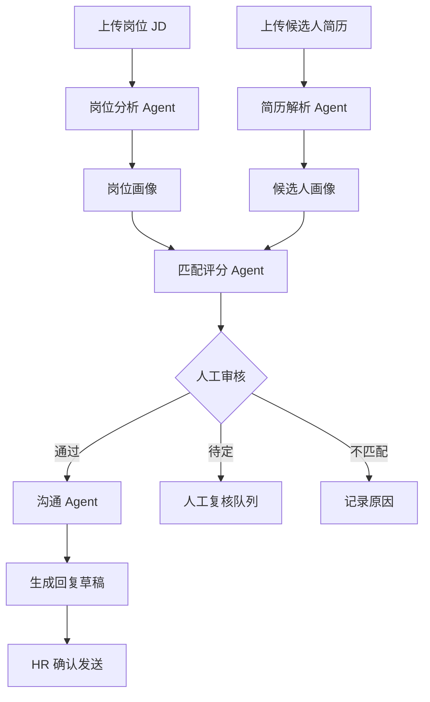
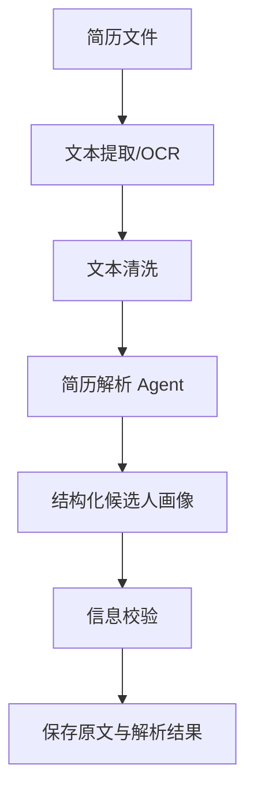
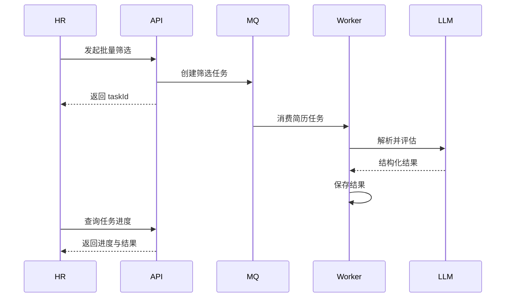

可以做，而且这个项目很适合你目前“Java 后端 + AI 应用开发”的求职方向。建议不要一开始就做“自动控制 BOSS 直聘、自动海投/自动聊天”，而是先做成一个独立的 AI 招聘助手，再根据平台是否提供正式授权接口决定是否接入。

项目可以命名为：

> RecruitAgent——基于大模型的智能简历筛选与招聘沟通系统

它不是简单调用一次 ChatGPT，而是一套包含简历解析、岗位匹配、筛选决策、回复生成、人工审批、知识库和效果评估的 Agent 系统。

---

## 一、项目最终要实现什么

系统包含招聘端和求职端两个方向，第一版优先做招聘端。

### 核心功能

1. HR 创建岗位 JD
2. 批量上传 PDF、Word 简历
3. 自动提取候选人的结构化信息
4. 根据岗位要求进行匹配和排序
5. 输出匹配分数、优势、风险和判断依据
6. 自动生成招聘沟通回复
7. HR 审核后发送或复制到招聘平台
8. 根据候选人后续回复，判断意图并生成下一轮话术
9. 保存完整筛选记录和 Agent 执行日志
10. 根据 HR 最终决定，反向优化评分规则

整个流程如下：



---

# 二、项目功能模块

## 1. 用户与权限模块

角色可以设计为：

* 系统管理员
* HR
* 招聘负责人
* 面试官

基础功能：

* 注册、登录
* JWT 鉴权
* 企业及部门管理
* RBAC 权限控制
* 操作审计日志

这部分使用你熟悉的 Spring Security 即可。

---

## 2. 岗位管理模块

HR 可以创建或导入岗位信息：

* 岗位名称
* 岗位描述
* 必须技能
* 加分技能
* 工作年限
* 学历要求
* 薪资范围
* 工作地点
* 岗位职责
* 一票否决条件
* 各项评分权重

岗位分析 Agent 将自然语言 JD 转换成结构化数据：

```json
{
  "jobName": "Java后端开发工程师",
  "requiredSkills": [
    "Java",
    "Spring Boot",
    "MySQL"
  ],
  "preferredSkills": [
    "Redis",
    "Kafka",
    "Docker"
  ],
  "education": "本科及以上",
  "experienceYears": {
    "min": 1,
    "max": 3
  },
  "weights": {
    "requiredSkills": 40,
    "projectExperience": 25,
    "workExperience": 15,
    "education": 10,
    "preferredSkills": 10
  },
  "hardConstraints": [
    "必须具有Java项目经验"
  ]
}
```

这里一定要使用 Structured Output，而不是让模型返回一段无法稳定解析的文本。

---

## 3. 简历解析模块

支持：

* PDF
* DOCX
* 图片简历 OCR
* 批量 ZIP 导入

解析流程：



需要提取的字段：

```json
{
  "name": "张三",
  "phone": "脱敏存储",
  "email": "脱敏存储",
  "education": [],
  "workExperiences": [],
  "projects": [],
  "skills": [],
  "certificates": [],
  "expectedSalary": null,
  "expectedCity": "成都",
  "totalExperienceYears": 2.5
}
```

需要特别保留两份数据：

* 原始简历文本
* AI 结构化结果

这样后面才能追溯“AI 为什么给出这个判断”。

---

## 4. 简历匹配与筛选模块

不要让大模型直接给出一个总分。推荐采用：

> 规则评分 + 向量相似度 + 大模型分析

### 第一层：硬性条件过滤

判断：

* 学历是否满足
* 工作地点是否匹配
* 工作年限是否满足
* 必须技能是否具备
* 是否存在一票否决项

这一层使用普通 Java 规则引擎完成，不依赖大模型。

### 第二层：量化评分

例如：

| 评分项  |  权重 | 实现方式        |
| ---- | --: | ----------- |
| 必须技能 | 40% | 关键词标准化与技能匹配 |
| 项目经历 | 25% | 向量相似度       |
| 工作经历 | 15% | 规则计算        |
| 学历   | 10% | 规则计算        |
| 加分技能 | 10% | 关键词匹配       |

可以设计为：

[
Score=0.4S_{skill}+0.25S_{project}+0.15S_{experience}+0.1S_{education}+0.1S_{bonus}
]

### 第三层：大模型复核

大模型不重新随意打分，而是根据证据输出：

```json
{
  "recommendation": "INTERVIEW",
  "confidence": 0.86,
  "advantages": [
    {
      "conclusion": "具备Spring Boot项目经验",
      "evidence": "参与企业状态查询系统开发，使用Spring Boot..."
    }
  ],
  "risks": [
    {
      "conclusion": "缺少高并发场景经验",
      "evidence": "简历中未发现相关项目描述"
    }
  ],
  "missingInformation": [
    "Kafka的实际使用规模",
    "项目中的个人职责"
  ],
  "suggestedQuestions": [
    "请介绍项目中Redis缓存一致性是如何处理的？"
  ]
}
```

关键原则是：没有简历证据时只能说“未发现”，不能判断候选人“不会”。

---

## 5. AI 回复模块

回复 Agent 根据以下上下文生成话术：

* 岗位信息
* 候选人简历
* 当前招聘阶段
* 历史聊天记录
* 企业沟通规范
* HR 常用话术知识库

常见意图包括：

* 初次打招呼
* 询问求职意愿
* 询问到岗时间
* 询问期望薪资
* 邀约面试
* 修改面试时间
* 回答岗位问题
* 婉拒候选人
* 无法判断，转人工处理

Agent 应先进行意图识别：

```json
{
  "intent": "ASK_SALARY",
  "confidence": 0.91,
  "needHuman": false,
  "suggestedReply": "该岗位薪资范围为15K～20K，具体会结合面试情况综合评估。请问您的期望薪资范围是多少？"
}
```

### 必须设计发送分级

| 场景         | 处理方式     |
| ---------- | -------- |
| 普通岗位介绍     | 可以允许自动生成 |
| 面试时间确认     | 生成后人工确认  |
| 薪资承诺       | 必须人工确认   |
| 录用或淘汰决定    | 必须人工确认   |
| 模型置信度低     | 转人工      |
| 候选人投诉或敏感问题 | 转人工      |

第一版建议只做“生成回复草稿 + 人工确认”，不要直接自动发送。

---

# 三、Agent 怎么设计

第一版不需要一上来就堆很多 Agent。建议拆成五个职责明确的 Agent。

| Agent       | 输入         | 输出         |
| ----------- | ---------- | ---------- |
| JD 分析 Agent | 岗位描述       | 结构化岗位画像    |
| 简历解析 Agent  | 简历文本       | 候选人画像      |
| 匹配 Agent    | 岗位、简历、规则分  | 匹配结论与证据    |
| 对话 Agent    | 聊天记录、岗位、简历 | 回复建议       |
| 审核 Agent    | AI 结果、业务规则 | 风险提示与是否转人工 |

Agent 的本质可以理解为：

> 大模型 + Prompt + 工具 + 状态 + 执行流程 + 安全限制

例如匹配 Agent 可以调用这些工具：

```java
public interface RecruitingTools {

    CandidateProfile getCandidate(Long candidateId);

    JobProfile getJob(Long jobId);

    SkillMatchResult matchSkills(
        CandidateProfile candidate,
        JobProfile job
    );

    SimilarityResult calculateProjectSimilarity(
        String resumeProject,
        String jobDescription
    );

    List<RecruitRule> getRecruitRules(Long jobId);

    void saveEvaluation(MatchEvaluation evaluation);
}
```

---

# 四、推荐技术架构

考虑到你想走 Java 后端或 AI 应用开发，建议以 Java 为主。

## 后端

* Java 17
* Spring Boot 3
* Spring Security
* MyBatis-Plus
* Spring AI
* Spring StateMachine，或者自己实现工作流状态机
* PostgreSQL/MySQL
* Redis
* RabbitMQ
* MinIO
* Elasticsearch，可在第二阶段加入
* pgvector 或 Milvus，用于向量检索

## AI 能力

* 大模型 API
* Embedding 模型
* Rerank 模型
* OCR
* Structured Output
* Function Calling
* RAG 知识库
* Prompt 版本管理
* 模型调用监控

如果使用 OpenAI 技术路线，当前官方文档提供 Responses API、工具调用、文件检索、Agents SDK、Guardrails 和 Agent 评估等能力，可以作为实现参考。[OpenAI API 文档](https://platform.openai.com/docs/api-reference/roles/project/list?lang=javascript)

## 前端

* Vue 3
* TypeScript
* Element Plus
* ECharts

## 部署

* Docker Compose
* Nginx
* GitHub Actions或其他 CI/CD
* Prometheus + Grafana
* Loki 或 ELK 日志系统

---

# 五、核心数据库设计

至少包含这些表：

```text
user
role
user_role
company
department

job
job_requirement
job_skill
recruit_rule

candidate
resume
candidate_education
candidate_experience
candidate_project
candidate_skill

job_application
resume_evaluation
evaluation_evidence

conversation
conversation_message
reply_suggestion

agent_task
agent_step
model_call_log
prompt_template
prompt_version

knowledge_document
knowledge_chunk

audit_log
```

关键表 `resume_evaluation`：

```sql
CREATE TABLE resume_evaluation (
    id BIGINT PRIMARY KEY,
    job_id BIGINT NOT NULL,
    candidate_id BIGINT NOT NULL,
    rule_score DECIMAL(5,2),
    semantic_score DECIMAL(5,2),
    final_score DECIMAL(5,2),
    recommendation VARCHAR(32),
    confidence DECIMAL(5,4),
    advantages JSON,
    risks JSON,
    missing_information JSON,
    model_name VARCHAR(64),
    prompt_version VARCHAR(32),
    human_result VARCHAR(32),
    created_at TIMESTAMP
);
```

保存 `prompt_version` 和 `model_name` 很重要，否则以后模型结果变化时无法追踪原因。

---

# 六、主要接口设计

## 岗位接口

```http
POST   /api/jobs
PUT    /api/jobs/{id}
GET    /api/jobs/{id}
POST   /api/jobs/{id}/analyze
PUT    /api/jobs/{id}/rules
```

## 简历接口

```http
POST   /api/resumes/upload
POST   /api/resumes/batch-upload
POST   /api/resumes/{id}/parse
GET    /api/candidates/{id}
```

## 筛选接口

```http
POST   /api/jobs/{jobId}/screen
GET    /api/jobs/{jobId}/candidates
GET    /api/evaluations/{id}
POST   /api/evaluations/{id}/human-review
```

## AI 回复接口

```http
POST   /api/conversations
POST   /api/conversations/{id}/messages
POST   /api/conversations/{id}/generate-reply
POST   /api/replies/{id}/approve
POST   /api/replies/{id}/reject
```

## Agent 任务接口

```http
POST   /api/agent-tasks
GET    /api/agent-tasks/{id}
GET    /api/agent-tasks/{id}/steps
POST   /api/agent-tasks/{id}/retry
```

批量筛选需要异步执行，不能让 HTTP 请求一直等待：



---

# 七、开发阶段安排

## 第一阶段：两周完成基础版本

目标：系统可以演示完整主流程。

完成：

* 登录与权限
* 岗位 CRUD
* 单份 PDF/DOCX 简历上传
* 简历文本提取
* AI 结构化解析
* 岗位与简历匹配
* 匹配结果页面
* AI 回复草稿

此时先不做向量数据库和复杂多 Agent。

## 第二阶段：两周完善工程能力

完成：

* 批量上传简历
* RabbitMQ 异步处理
* 任务进度查询
* Redis 缓存
* 失败重试
* 幂等控制
* Prompt 版本管理
* 模型调用日志
* Token 与费用统计
* 人工审核工作流

## 第三阶段：两周增加 Agent 和 RAG

完成：

* 招聘话术知识库
* 企业制度知识库
* 向量检索
* 多轮对话状态管理
* 自动识别候选人意图
* 敏感场景转人工
* Agent 执行步骤展示
* 引用来源展示

## 第四阶段：两周做评估与上线

完成：

* 建立简历测试集
* 模型效果评估
* Prompt 对比实验
* 公平性测试
* Docker 部署
* 监控告警
* 演示视频
* README
* 项目架构图
* 接口文档

完整版本约 6～8 周；如果只用于简历项目，4 周可以完成一个较好的 MVP。

---

# 八、如何评估这个 Agent

Agent 项目最容易被面试官追问：

> 你怎么证明 AI 的结果是可靠的？

因此必须准备测试集，例如收集或构造 200 份脱敏简历，由人工标注：

* 推荐面试
* 待人工判断
* 不推荐
* 关键技能
* 不匹配原因

评估指标包括：

| 模块       | 指标                  |
| -------- | ------------------- |
| 简历解析     | 字段准确率、字段召回率         |
| 技能识别     | Precision、Recall、F1 |
| 简历筛选     | 准确率、召回率、Top-K 命中率   |
| 回复 Agent | 意图识别准确率、人工采纳率       |
| 系统性能     | 平均耗时、P95、失败率        |
| 成本       | 单份简历 Token 和费用      |
| 稳定性      | JSON 解析成功率、重试率      |

特别关注“合格候选人被错误淘汰”的情况，因此筛选时不能只看 Accuracy，还要关注合格候选人的 Recall。

---

# 九、BOSS 直聘接入应该怎么处理

推荐的产品路线是：

1. MVP 使用用户主动上传的脱敏简历。
2. AI 只生成回复建议，由 HR 手动确认和复制。
3. 如果平台提供企业授权接口，再通过正式 API 接入。
4. 不要通过爬虫批量抓取候选人简历。
5. 不要模拟点击、绕过验证码或规避风控。
6. 不要在未经平台及候选人授权的情况下保存、转售或二次使用简历数据。

最高人民法院发布的数据权益指导性案例已经明确，平台数据集合形成的经营性利益可能受到法律保护，爬取搬运平台数据可能构成不正当竞争。[最高人民法院数据权益指导性案例](https://ipc.court.gov.cn/zh-cn/news/view-4588.html)

招聘筛选又涉及个人信息和自动化决策。《个人信息保护法》要求自动化决策保持透明、公平、公正；对个人权益有重大影响的决定，个人可以要求说明并拒绝仅由自动化方式作出。[个人信息保护法相关说明](https://wqb.hunan.gov.cn/wqb/xxgk/zcfg/202111/t20211101_20954693.html)

所以产品设计上应该坚持：

> AI 提供辅助建议，最终录用、淘汰和薪资决定由人工确认。

同时要进行信息脱敏、权限控制、访问审计、数据最小化、定期删除，并且不把性别、年龄、婚育情况、籍贯等非岗位必要信息用于评分。

---

# 十、这个项目在简历上怎么写

可以描述为：

> 设计并实现基于 Spring Boot、OpenAI 兼容模型接口和 RAG 的智能招聘 Agent 系统，完成 PDF/DOCX 简历结构化解析、岗位画像生成、规则与语义融合匹配、候选人排序及招聘回复生成；采用 RabbitMQ 实现批量筛选异步处理，通过 Structured Output 保证模型输出稳定性，并设计人工审核、Prompt 版本管理、模型调用追踪和低置信度转人工机制。

项目亮点不要写成“调用大模型筛选简历”，而要突出：

* Agent 工作流设计
* 大模型和业务规则结合
* 异步任务与失败重试
* RAG 与证据引用
* 人工审批机制
* AI 评估体系
* 隐私和自动化决策合规

建议第一版聚焦四个页面：岗位管理、简历批量上传、匹配结果排行、AI 沟通工作台。先把这条完整链路做扎实，比一开始开发自动操作 BOSS 直聘更有项目价值。

---

## 当前后端实现状态

Java 17 后端的招聘主链路已经实现，包括真实大模型兼容接口、MySQL 持久化、PostgreSQL + pgvector、
简历解析、融合筛选、批量后台任务、人工审核、AI 沟通、Prompt 版本、模型监控和 RAG 知识检索。

可运行接口、数据库账号、启动命令以及仍属于生产增强的事项见
[后端实现状态](docs/BACKEND_STATUS.md)。
结合你现在的 Java 基础和“软件开发 + AI 应用开发”求职方向，这个项目建议采用下面这套技术栈。

## 一、推荐技术栈

| 模块    | 推荐技术                           | 作用                   |
| ----- | ------------------------------ | -------------------- |
| 前端    | Vue 3、TypeScript、Element Plus  | HR 管理后台              |
| 图表    | ECharts                        | 展示匹配分数、任务统计          |
| 后端    | Java 17、Spring Boot 3          | 核心业务服务               |
| ORM   | MyBatis-Plus                   | 数据库访问                |
| 权限    | Spring Security、JWT            | 登录、认证、RBAC           |
| AI 接入  | OpenAI 兼容 HTTP 客户端（可后续替换为 Spring AI） | 调用大模型和 Embedding |
| 工作流   | LangGraph4j 或自定义状态机            | 编排 Agent 流程          |
| 数据库   | MySQL 8                        | 岗位、简历、会话、评估结果        |
| 缓存    | Redis                          | 缓存、会话、限流、任务进度        |
| 消息队列  | RabbitMQ                       | 批量简历异步解析             |
| 文件存储  | MinIO                          | 保存 PDF、Word 简历       |
| 向量数据库 | PostgreSQL + pgvector          | RAG 和语义匹配            |
| 文档解析  | Apache Tika、PDFBox、POI         | 提取 PDF、DOCX 内容       |
| OCR   | PaddleOCR                      | 识别扫描版简历              |
| 接口文档  | Knife4j / OpenAPI              | 接口调试与展示              |
| 部署    | Docker、Docker Compose、Nginx    | 项目部署                 |
| 监控    | Prometheus、Grafana             | 系统指标监控               |
| 日志    | SLF4J、Logback、Loki             | 日志采集与查询              |
| 测试    | JUnit 5、Mockito、Testcontainers | 单元和集成测试              |

---

## 二、最核心的技术组合

如果是个人项目，不要第一版把全部技术都堆进去。第一版先使用：

```text
Vue 3 + TypeScript
        ↓
Spring Boot 3 + Spring AI
        ↓
MySQL + Redis
        ↓
MinIO
        ↓
大模型 API
```

第二版再增加：

```text
RabbitMQ
PostgreSQL + pgvector
PaddleOCR
Prometheus + Grafana
Docker Compose
```

---

## 三、各部分具体选择

### 1. 后端技术

建议使用：

```text
Java 21
Spring Boot 3
Spring MVC
Spring Security
MyBatis-Plus
Hibernate Validator
MapStruct
Lombok
```

主要负责：

* 用户登录和权限
* 岗位管理
* 候选人管理
* 简历上传
* 招聘流程管理
* AI 任务调度
* 人工审核
* 操作日志

如果考虑国内 Java 岗位兼容性，也可以使用 Java 17，它在企业项目中更加常见。

---

### 2. AI 技术

核心建议使用 Spring AI：

```text
Spring AI
Chat Model
Embedding Model
Structured Output
Tool Calling
RAG
Conversation Memory
Prompt Template
```

Spring AI 负责连接业务系统和大模型。

例如：

```java
@Service
@RequiredArgsConstructor
public class ResumeAgentService {

    private final ChatClient chatClient;

    public ResumeEvaluation evaluate(
            JobProfile job,
            ResumeProfile resume) {

        return chatClient.prompt()
                .system("""
                    你是招聘筛选助手。
                    必须根据简历中的明确证据进行判断。
                    没有证据时只能输出“简历中未体现”。
                    不得根据年龄、性别、籍贯进行判断。
                    """)
                .user("""
                    岗位要求：
                    {job}

                    候选人简历：
                    {resume}
                    """)
                .param("job", job)
                .param("resume", resume)
                .call()
                .entity(ResumeEvaluation.class);
    }
}
```

---

### 3. 大模型选择

系统最好通过统一接口支持多个模型，而不是写死某一家：

```java
public interface LlmService {

    <T> T structuredChat(
        String systemPrompt,
        String userPrompt,
        Class<T> resultType
    );

    List<Float> embedding(String text);
}
```

可接入：

* OpenAI
* 通义千问
* DeepSeek
* 智谱 GLM
* 火山方舟
* 本地部署模型

个人项目初期选择一个支持结构化输出和工具调用的模型即可。

---

### 4. 数据库

#### MySQL

存储结构化业务数据：

* 用户
* 岗位
* 候选人
* 简历
* 申请记录
* AI 评分
* 人工复核结果
* 聊天记录
* Agent 执行记录

#### Redis

用于：

* 登录状态
* 验证码
* 热点岗位缓存
* Agent 任务进度
* 分布式锁
* 接口限流
* 对话短期记忆
* 幂等控制

#### pgvector

用于保存：

* 简历项目经历向量
* 岗位描述向量
* 企业话术知识库
* 招聘制度知识库

个人项目不建议同时引入 Milvus。数据规模不大时，PostgreSQL + pgvector 已经足够。

不过这样会形成 MySQL 和 PostgreSQL 两套数据库。为了简化，也可以直接使用 PostgreSQL 作为主数据库，再通过 pgvector 保存向量。这是我更推荐的方式：

```text
PostgreSQL + pgvector
```

替代：

```text
MySQL + 单独的向量数据库
```

---

### 5. 消息队列

推荐 RabbitMQ，因为你的业务更强调任务可靠执行，而不是超高吞吐日志流。

适用场景：

* 批量解析简历
* OCR 任务
* 简历匹配任务
* 生成候选人报告
* 模型调用失败重试

```text
上传100份简历
    ↓
创建批次任务
    ↓
每份简历发送一条RabbitMQ消息
    ↓
消费者并发解析
    ↓
更新Redis任务进度
    ↓
结果写入PostgreSQL
```

需要处理：

* 消息确认
* 重试队列
* 死信队列
* 消费幂等
* 重复消息
* 模型接口限流

---

### 6. 文档解析

普通 PDF：

```text
Apache PDFBox
```

Word：

```text
Apache POI
```

多格式统一解析：

```text
Apache Tika
```

扫描版 PDF 和图片：

```text
PaddleOCR
```

建议处理顺序：

```text
Tika/PDFBox提取文本
        ↓
判断文本是否为空或过少
        ↓
为空时调用PaddleOCR
        ↓
文本清洗
        ↓
大模型结构化解析
```

---

### 7. 文件存储

推荐 MinIO，保存：

* 原始简历
* 简历解析文件
* 候选人附件
* 导出的招聘报告

数据库只保存：

```text
file_id
bucket_name
object_name
file_url
file_hash
content_type
file_size
```

文件不要直接以 BLOB 形式存进数据库。

---

### 8. 前端

```text
Vue 3
TypeScript
Vite
Element Plus
Pinia
Vue Router
Axios
ECharts
```

主要页面：

* 登录页
* 岗位列表
* 岗位详情
* 简历批量上传
* 候选人排行榜
* AI 评估详情
* 招聘聊天工作台
* Agent 执行日志
* 模型调用统计

---

### 9. 部署与运维

个人项目使用 Docker Compose 足够：

```text
Nginx
前端
Spring Boot
PostgreSQL + pgvector
Redis
RabbitMQ
MinIO
Prometheus
Grafana
```

不建议第一版直接上 Kubernetes。K8s 会显著增加环境和部署成本，但对个人项目的核心功能提升不大。

你可以在第二阶段把 K8s 写成扩展部署方案。

---

## 四、推荐项目结构

前后端分离：

```text
recruit-agent/
├── recruit-agent-web
├── recruit-agent-server
├── deploy
│   ├── docker-compose.yml
│   ├── nginx
│   └── sql
└── docs
```

后端建议先用模块化单体：

```text
recruit-agent-server/
├── recruit-common
├── recruit-auth
├── recruit-job
├── recruit-candidate
├── recruit-resume
├── recruit-agent
├── recruit-conversation
├── recruit-knowledge
└── recruit-start
```

不建议第一版拆微服务。模块化单体已经能体现良好的架构设计，而且开发、部署和调试都更简单。

---

## 五、最终推荐方案

### 简历项目版

```text
前端：Vue 3 + TypeScript + Element Plus
后端：Java 17/21 + Spring Boot 3 + Spring AI
权限：Spring Security + JWT
数据库：PostgreSQL + pgvector
缓存：Redis
消息队列：RabbitMQ
文件存储：MinIO
文档解析：Tika + PDFBox + POI
OCR：PaddleOCR
部署：Docker Compose + Nginx
监控：Prometheus + Grafana
```

这套技术栈既有传统 Java 后端内容，也有 Agent、RAG、结构化输出、异步任务和 AI 评估，比较契合你软件开发和 AI 应用开发两个求职方向。
# P1 Agent 可观测性

管理员可以通过 `GET /api/agent-traces?traceId=...` 查询一次端到端执行。
可使用 `component`（`AGENT`、`RETRIEVAL`、`TOOL`、`MODEL`）和 `status`
筛选时间线。Trace 明细和模型调用日志在持久化前会自动脱敏手机号、邮箱、
身份证号、API Key 和 Bearer Token。

经过人工审阅的匿名对话可以直接进行离线评测，不会调用真实模型：

```http
POST /api/evaluations/reviewed-baseline
Content-Type: application/x-ndjson
```

接口接受 `anonymized-conversation-evaluation/v1` 格式；每条记录必须声明
`candidate-pii-removed/v1`，并通过严格的隐私和结构校验。

## P2 混合检索质量

`vector` profile 下的知识库检索采用：

```text
pgvector Dense Recall + Lucene BM25/SmartCN Recall
                         ↓
                        RRF
                         ↓
              Heuristic Second-stage Reranker
```

知识文档会在全部 Embedding 成功后一次性事务写入 PostgreSQL，避免只写入部分
切片。BM25 索引可从 PostgreSQL 自动重建；Embedding 服务不可用时会降级为
BM25-only 检索。

管理员可通过 `POST /api/evaluations/retrieval-comparison?k=5` 比较重排前后的
Candidate Recall、Recall@K、MRR、nDCG、延迟和降级率。
