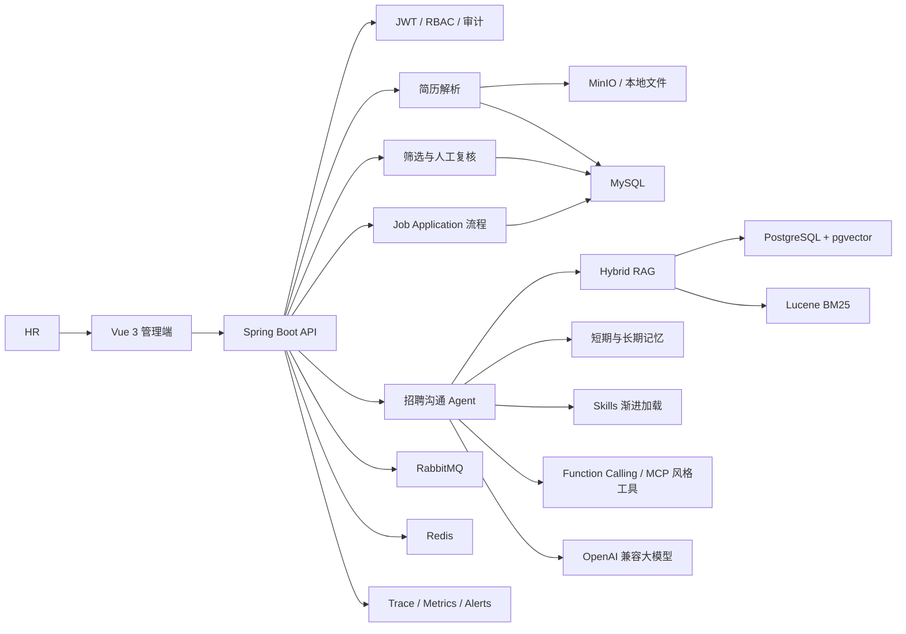

# RecruitAgent

基于 Java 17、Spring Boot 3 和大模型能力构建的智能招聘 Agent 系统。

RecruitAgent 面向 HR 的真实招聘流程，将岗位管理、简历解析、候选人筛选、招聘沟通、知识库检索和人工审核串成一条完整链路。项目重点不是简单调用一次大模型，而是让 AI 能在可追踪、可恢复、可评测、可人工干预的工程体系中参与招聘工作。

> AI 只提供辅助分析和回复建议，最终筛选、淘汰、录用及薪资决策由人工确认。

## 项目能力

### 招聘业务闭环

- 岗位创建、编辑、状态管理和 JD 结构化分析
- 候选人管理与 PDF、DOCX 等格式的简历上传
- Apache Tika 文本提取、OCR 降级和简历结构化解析
- 规则评分、语义分析和证据引用相结合的候选人筛选
- 人工复核、筛选结论修正和审核记录
- AI 招聘沟通、意图识别、回复建议及采纳/拒绝
- `job_application` 招聘流程状态机和完整阶段历史
- 批量筛选任务、执行步骤、失败重试和持久化检查点

招聘流程覆盖：

```text
投递 APPLIED
  -> 筛选 SCREENING
  -> HR 复核 HR_REVIEW
  -> 沟通 COMMUNICATION
  -> 面试 INTERVIEW
  -> Offer
  -> 入职 HIRED
```

同时支持 `REJECTED`、`WITHDRAWN` 和 `CLOSED` 等终态，并保存每次阶段变化的原因、操作人和时间。

### Agent 能力

- 使用 LangGraph4j 编排对话与回复生成工作流
- Function Calling 工具规划、参数校验、权限控制和幂等执行
- MCP 风格的工具发现、Schema 展示和调用调试接口
- 候选人长期记忆，可在后续沟通中召回重要事实
- 招聘 Skills 中心，按“描述匹配 -> 正文加载”的方式渐进披露上下文
- 会话摘要与短期记忆预算，避免历史消息无限占用上下文
- Prompt 版本管理、模型调用日志和结构化输出校验
- 统一 Trace 串联 Agent、检索、Skill、Memory、Tool 和 Model 执行过程

### RAG 知识库

知识库用于保存招聘话术、企业制度、岗位说明和面试规范等文档。对话生成前，系统会根据当前问题召回相关内容，并将引用证据注入模型上下文。

当前检索链路：

```text
问题改写 / Multi-Query
        |
        +-- pgvector Dense Recall
        |
        +-- Lucene BM25 + SmartCN Sparse Recall
        |
        v
       RRF 融合
        |
        v
Heuristic 或 HTTP Cross-Encoder Reranker
        |
        v
上下文组装 + 引用来源
```

主要能力包括：

- PostgreSQL + pgvector 向量存储与相似度召回
- OpenAI 兼容 Embedding 接口，可接入独立 Embedding 服务
- 未配置真实 Embedding 时使用确定性本地向量，便于离线开发
- Lucene BM25 中文关键词检索和 RRF 混合召回
- Multi-Query 问题改写，提升不同表达方式下的召回率
- 外部 Cross-Encoder Reranker，并在超时或异常时自动回退
- Embedding 模型版本、索引重建、激活、回滚和双版本治理
- Recall@K、MRR、nDCG、延迟和降级率等检索质量评测

### 可观测性与稳定性

- Agent 端到端 Trace 和节点级执行状态
- 模型调用次数、成功率、延迟、Token 等运行指标
- Prometheus 指标和 Grafana 展示基础
- 模型失败率、延迟、Trace 失败率等告警检测
- 告警事件持久化、去重、冷却、Webhook 通知、失败重试和恢复
- RabbitMQ 异步任务、Redis 状态支持和任务重启恢复
- 敏感信息脱敏，避免手机号、邮箱、Token 等进入持久化 Trace
- 脱敏会话评测集和离线 Agent/RAG 质量报告

## 系统链路



## 技术栈

| 领域 | 技术 |
| --- | --- |
| 后端 | Java 17、Spring Boot 3.3、Spring MVC、Spring Security |
| 数据访问 | MyBatis-Plus、Flyway |
| 主数据库 | MySQL 8.4 |
| 向量数据库 | PostgreSQL 16、pgvector |
| Agent 编排 | LangGraph4j、自定义 Function Calling |
| AI 接入 | OpenAI 兼容 Chat / Embedding HTTP Client |
| 混合检索 | pgvector、Lucene BM25、SmartCN、RRF、Cross-Encoder |
| 文档处理 | Apache Tika、PDFBox、POI、OCR |
| 中间件 | Redis、RabbitMQ、MinIO |
| 可观测性 | Actuator、Micrometer、Prometheus、Grafana |
| 前端 | Vue 3、TypeScript、Vite、Element Plus、Pinia、ECharts |
| 测试 | JUnit 5、Mockito、Testcontainers |
| 部署 | Docker Compose、Nginx |

项目没有强依赖 Spring AI。当前采用自定义的 OpenAI 兼容客户端和领域接口隔离模型供应商，便于接入 DeepSeek、OpenAI 兼容模型及独立 Embedding/Reranker 服务；后续也可以在不改变业务层的情况下替换为 Spring AI。

## 工程设计

后端采用模块化单体架构。业务按领域拆分，但共享同一个 Spring Boot 进程，兼顾边界清晰和本地开发成本。

```text
recurit/
├── recruit-start/          # Java 后端
│   ├── auth/               # 登录、JWT、RBAC
│   ├── candidate/          # 候选人与简历
│   ├── job/                # 岗位管理
│   ├── jobapplication/     # 招聘流程
│   ├── screening/          # 筛选与人工复核
│   ├── conversation/       # AI 沟通
│   ├── knowledge/          # RAG 知识库
│   ├── retrieval/          # 混合检索与重排
│   ├── vector/             # 向量与索引治理
│   ├── memory/             # 候选人长期记忆
│   ├── skill/              # 招聘 Skills
│   ├── toolcalling/        # Function Calling
│   ├── mcp/                # MCP 风格工具接口
│   ├── trace/              # Agent Trace
│   ├── ops/                # 监控与告警闭环
│   └── task/               # 异步任务与恢复
├── recruit-agent-web/      # Vue 3 前端
├── deploy/                 # Docker Compose 与基础设施
└── docs/                   # 工作流、TDD 和后端状态文档
```

数据职责保持清晰：

- MySQL 保存用户、岗位、候选人、简历、筛选结果、会话、任务、流程和告警等结构化业务数据。
- PostgreSQL + pgvector 保存知识文档切片及其向量索引。
- MinIO 保存原始简历等文件，数据库只保存文件元数据。
- Redis 提供缓存、幂等和任务运行状态支持。
- RabbitMQ 承担批量筛选等异步任务。

## 快速启动

### 1. 启动基础设施

在项目根目录执行：

```powershell
docker compose -f deploy/docker-compose.yml up -d
```

默认端口：

| 服务 | 地址 |
| --- | --- |
| MySQL | `localhost:13307` |
| PostgreSQL + pgvector | `localhost:5432` |
| Redis | `localhost:6379` |
| RabbitMQ 管理台 | `http://localhost:15672` |
| MinIO 控制台 | `http://localhost:9001` |

MySQL 默认数据库为 `recruit_agent`，PostgreSQL 默认数据库为 `recruit_vector`。首次启动后，Flyway 会自动创建和升级 MySQL 表结构。

### 2. 配置环境变量

复制 `.env.example` 为 `.env`，再填写自己的模型密钥。密钥只保存在本地，不要提交到 Git。

```properties
AI_ENABLED=true
AI_BASE_URL=https://api.deepseek.com/chat/completions
AI_API_KEY=your-api-key
AI_MODEL=deepseek-v4-flash
```

DeepSeek Chat 接口不提供 Embedding 时，需要另外配置一个 OpenAI 兼容的 Embedding 服务。不开启真实 Embedding 也可以运行本地开发模式。

### 3. 启动后端

IDEA 启动 `RecruitAgentApplication`，Active profiles 推荐填写：

```text
mysql,vector,distributed,minio
```

后端默认地址为 `http://localhost:8080`。如果端口被占用，可增加启动参数：

```text
--server.port=8081
```

### 4. 启动前端

```powershell
cd recruit-agent-web
npm install
npm run dev
```

前端默认地址为 `http://localhost:5173`，开发代理默认转发到 `http://localhost:8080`。

也可以直接启动完整容器环境：

```powershell
docker compose -f deploy/docker-compose.yml --profile app up -d --build
```

此时前端地址为 `http://localhost:8088`，后端映射地址为 `http://localhost:8081`。

## 数据库迁移

MySQL 迁移脚本位于：

```text
recruit-start/src/main/resources/db/mysql
```

当前迁移覆盖核心业务表、审计日志、简历结构化详情、Agent Trace、会话摘要、任务检查点、招聘 Skills、候选人长期记忆、`job_application` 流程和告警事件。

通常不需要手工执行 SQL。使用 `mysql` Profile 启动后端时，Flyway 会按版本自动执行尚未应用的迁移。

## 测试

后端已按领域提供单元测试和集成测试，可按需运行目标测试：

```powershell
mvn -pl recruit-start -Dtest=JobApplicationPipelineServiceTest test
mvn -pl recruit-start -Dtest=AlertLifecycleServiceTest test
```

需要完整验证时执行：

```powershell
mvn -pl recruit-start test
```

## 项目亮点

- 不是单次 LLM 调用，而是覆盖招聘业务、Agent 编排、工具调用、记忆和人工审核的完整系统。
- RAG 同时具备 Dense、BM25、RRF、Multi-Query 和 Reranker，并能用指标验证检索改进。
- Embedding 索引支持模型版本治理、重建和回滚，避免模型切换后直接破坏线上知识库。
- Agent Trace、模型监控和告警通知形成“发现异常 -> 去重 -> 通知 -> 重试 -> 恢复”的闭环。
- 招聘 Skills 使用渐进披露，只有命中场景后才加载完整内容，控制上下文长度和 Token 成本。
- 候选人长期记忆与会话摘要结合，使多轮招聘沟通具备连续性。
- `job_application` 将 AI 能力落到真实招聘阶段流转，而不是停留在孤立的演示接口。
- 模型输出保留证据和人工复核入口，避免将自动化评分直接等同于招聘决策。

## 相关文档

- [后端实现状态](docs/BACKEND_STATUS.md)
- [Agent 工作流](docs/agent-workflow.md)
- [TDD 开发约定](docs/tdd.md)

## 项目状态

当前版本已具备本地完整演示所需的招聘主链路、RAG、Agent 工具调用、长期记忆、Skills、可观测性和告警能力。外部标准 MCP Server、真实日历平台和生产级多租户属于后续扩展方向，不在当前版本中冒充已完成能力。
